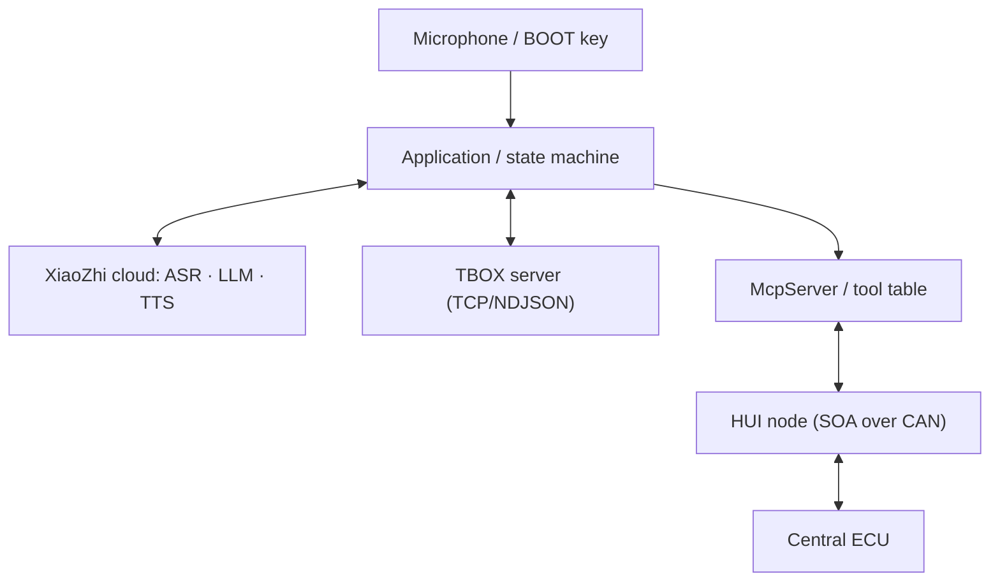

# AI Connector

(English | [中文](README_zh.md))

Based on [xiaozhi-esp32](https://github.com/78/xiaozhi-esp32) (MIT), this ESP32-S3 firmware is **one chip and one image that is both an AIBOX and a TBOX.**

- **AIBOX** — connects over Cat.1 4G and talks to large models such as Qwen / DeepSeek (Opus streaming, server-side AEC interruption).
- **TBOX** — a node on the vehicle CAN bus: the **HUI node** of the SOA framework, driving the central ECU through MCP tools.
- **Both control paths share a single tool table** — the model calls it during a conversation, and an operator can also pick a command from a server console.

End to end: press BOOT and speak → cloud ASR + LLM + TTS → `tools/call` → the firmware encodes the request into a CAN frame from the command manual → the central ECU answers → the result travels back to the model / the server.

## Capabilities

| Capability | Implementation |
| --- | --- |
| Voice | ES8311 codec + NS4150B amplifier, full-duplex I2S; Opus streaming; wake by BOOT key; server-side AEC allows interrupting playback |
| Network | ML307C Cat.1 4G (AT channel, PWRKEY power-on); the `ml307_net_heal` watchdog recovers the modem from the "no network + SIM unavailable" deadlock |
| Vehicle control | SOA/HUI node on the vehicle CAN bus (TWAI, 500 kbps), built on canard/Cyphal |
| MCP tools | Command manual → one `self.hui.*` tool per command, with real JSON Schema parameters |
| Dual path | Cloud MCP for the model plus an independent TBOX link (TCP/NDJSON); neither depends on the other |
| Command manual | JSON packed into the assets partition — available at boot, no network needed, updatable on its own |
| OTA | Inherits the upstream OTA (`CONFIG_OTA_URL`); MQTT / WebSocket settings are delivered by OTA |
| Other | No display, camera or touch; WS2812 status LED; localized voice prompts (upstream assets) |

> This board uses `CONFIG_SPIRAM=n`, so ESP-SR offline wake-up is not available (no AFE / WakeNet) and BOOT is the wake key.
> To enable a wake word, first move the amplifier enable off IO37 — IO37 is the DQS line of the octal PSRAM.

## Architecture

```text
main/
├── application.*            main event loop, protocol lifecycle, high-level behavior
├── device_state_machine.*   runtime state machine (only via Application::SetDeviceState)
├── protocols/               WebSocket and MQTT + UDP transports (same Protocol semantics)
├── mcp_server.*             tool table and tools/call dispatch (shared by both paths)
├── tbox_link.*              TBOX link: TCP (optional TLS) + newline-delimited JSON
├── soa/
│   ├── Sop/                 SOA layer: router + CAN/IPC/UART/ESP-NOW + canard
│   ├── hui.*                HUI node (identity and heartbeat on the bus)
│   ├── hui_rpc.*            synchronous read/write/ioctl transactions (serialized, late replies dropped)
│   ├── hui_manual.*         command manual loading (assets partition first)
│   ├── hui_mcp.*            manual → MCP tools
│   └── manuals/             per-host command manual JSON (packed into the assets partition)
├── boards/es8311-ml307-4g-voice/   the only board implementation shipped here
└── Kconfig.projbuild        audio / SOA / TBOX options
```



## One tool table, two control paths

| | AI path | TBOX link |
| --- | --- | --- |
| Trigger | the cloud model (`tools/call`) | a person picking a command on the server |
| Connection | MQTT / WebSocket config delivered by OTA (third-party backend) | TCP dialed by the device, TLS optional |
| Configuration | OTA, stored in NVS | Kconfig `CONFIG_TBOX_LINK_*`, NVS namespace `tbox` wins |
| Downlink | standard JSON-RPC | `{"type":"command",name,arguments}`, `{"type":"mcp","payload":…}` or bare JSON-RPC |
| Uplink | back on the AI path | `{"type":"mcp","payload":…}` on the same connection |

Design constraints:

- **Exactly one tool table.** Both paths end in `McpServer::CallTool()`, so argument validation, manual byte encoding and in-tool safety gates exist once. Calling `HuiNode_*` directly is forbidden — on a vehicle bus a wrong byte is not recoverable.
- **The link must be independent.** The AI backend is third-party and its settings come from OTA; we can neither change it nor let the TBOX server borrow that session.
- **No second MQTT client.** The ML307 `MQTTSTATE` URC carries no client index, so two `Ml307Mqtt` instances clear each other's `connected_` (measured on hardware: whichever connects later silences the other). The TBOX link therefore uses TCP + newline-delimited JSON.
- **Connection ids must not collide.** On the ML307 the id passed to `CreateTcp/Udp(id)` goes straight into `AT+MIPOPEN=<id>`; the displaced socket receives no URC at all and dies silently. In use: `0` MQTT/HTTP, `1` WebSocket, `2` AI audio UDP, `3` camera/upgrade HTTP, `4` TBOX link.
- **A failed send means reconnect.** A socket closed silently never delivers `OnDisconnected`, so a failed `SendJson()` is the most reliable failure signal.

## MCP tools generated from the command manual

The HUI bus exposes only three generic services: `read` (301), `write` (302) and `ioctl` (303). Command numbers are not self-describing, and the same function has a different number on different hosts. The firmware therefore:

1. reads `0x1000` at boot to learn the device ID from the central ECU;
2. looks up that device's command manual in the assets partition (or fetches it from the backend when online);
3. creates **one MCP tool per command**, with a real JSON Schema generated from the manual's `args`;
4. encodes the bytes itself (big-endian, ioctl prepends the 2-byte command code) — the model only speaks human terms.

```text
self.hui.<alias|host_<device_id>>.<command name>

self.hui.host1.get_device_id()
self.hui.host1.get_battery()            -> {"command":"FF01","ok":true,"raw":"55","value":85,"unit":"%"}
self.hui.host1.set_headlight(on=true)   -> ioctl F101 01
```

```json
{"jsonrpc":"2.0","id":7,"method":"tools/call",
 "params":{"name":"self.hui.host1.set_headlight","arguments":{"on":true}}}
```

Known limits: `tools/list` is capped at 8000 bytes per page, each description is truncated to 5500 bytes, and `HUI_MCP_MAX_TOOLS = 24`. Commands beyond that are not listed as tools; trim the manual or group commands.

See [HUI command manual → MCP tools](docs/hui-command-manual_zh.md) for the full rules (Chinese).

## Hardware

Only one board is maintained: `es8311-ml307-4g-voice` (ESP32-S3-WROOM-1-N16R8 + ES8311 + ML307C). The full pinout, power notes and bring-up details are in the [board README](main/boards/es8311-ml307-4g-voice/README.md) (Chinese).

| Function | Pins |
| --- | --- |
| BOOT key (wake) | IO0 (pulled up, active low) |
| Status LED (WS2812) | IO38 |
| Amplifier enable PA_EN (active high) | IO37 |
| I2S MCLK / BCLK / LRCK | IO4 / IO15 / IO6 |
| I2S DOUT → ES8311 `DSDIN` (crossed on this board) | IO5 |
| I2S DIN ← ES8311 `ASDOUT` (crossed on this board) | IO7 |
| Codec I2C SDA / SCL | IO17 / IO18 |
| 4G UART (ESP TX / RX), PWRKEY, STATE | IO44 / IO43, IO47, IO48 |
| CAN (TWAI): TX / RX / STB | IO39 / IO40 / IO41 (500 kbps) |
| USB-Serial/JTAG console | IO19 / IO20 (must stay reserved) |

Two traps worth remembering:

- **The I2S data lines are crossed on the PCB**: ES8311 `DSDIN` is wired to ESP `IO5` and `ASDOUT` to `IO7`. The conventional `DOUT=IO7 / DIN=IO5` yields "every clock correct, every codec register correct, speaker completely silent".
- **PSRAM must stay off**: IO37 is the DQS line of the octal PSRAM, so `CONFIG_SPIRAM=y` hands it to MSPI and `gpio_set_level` can no longer drive the amplifier enable — the speaker goes silent.

## Getting started

> Clone with submodules: `git clone --recurse-submodules https://github.com/PurplePassiom/AI-Connector.git`.
> The SOA layer lives in the `main/soa/Sop` submodule ([PurplePassiom/Sop](https://github.com/PurplePassiom/Sop),
> branch `sop_esp32`); for an existing checkout run `git submodule update --init --recursive`, otherwise the
> link step fails on the `soa_*` symbols.

### Requirements

- ESP-IDF **v6.0.1 or later**, [v6.1](https://github.com/espressif/esp-idf/releases/tag/v6.1) recommended; ESP-IDF 5.x is not supported
- VS Code / Cursor with the ESP-IDF extension, or a plain command line
- Google C++ style; format touched files as described in [code style](docs/code_style.md)

### Build

```sh
# source the target ESP-IDF environment first
. $IDF_PATH/export.sh          # Windows PowerShell: . $env:IDF_PATH\export.ps1

python scripts/build.py --list-boards
python scripts/build.py es8311-ml307-4g-voice --name es8311-ml307-4g-voice
```

> `scripts/build.py` is the only entry point for board configuration: it regenerates the local
> `sdkconfig` and overlays the `sdkconfig_append` entries from `config.json`. Do not reconfigure
> with a bare `idf.py` (it falls back to esp32 and prunes dependencies).

### Flash

```sh
idf.py -DIDF_TARGET=esp32s3 -p <PORT> flash monitor
```

A single `flash` writes both the app and the assets partition (which holds `main/soa/manuals/*.json`). To update only the manuals, no app reflash is needed:

```sh
esptool --chip esp32s3 write-flash 0x800000 build/generated_assets.bin
```

### Host-side tests

```sh
python -m unittest discover -s scripts/tests -v
```

## Configuration

Board defaults live in the `sdkconfig_append` list of `main/boards/es8311-ml307-4g-voice/config.json`:

| Option | Meaning |
| --- | --- |
| `CONFIG_SOA_ENABLE` | enable the SOA layer and the HUI node |
| `CONFIG_SOA_ESPNOW_ENABLE` | also enable the ESP-NOW transport (useful for testing without CAN) |
| `CONFIG_HUI_RPC_TIMEOUT_MS` | HUI transaction timeout. The central ECU answers in about 500 ms; too tight a value times out every request and drops the late reply — the device ID never arrives and the model sees no tools |
| `CONFIG_HUI_MANUAL_READ_TIMEOUT_MS` | timeout for loading a command manual (flash or network) |
| `CONFIG_TBOX_LINK_ENABLE` | enable the independent TBOX link |
| `CONFIG_TBOX_LINK_ENDPOINT` | `host:port` |
| `CONFIG_TBOX_LINK_TLS` | use TLS for the link |
| `CONFIG_TBOX_LINK_CHANNEL` / `CLIENT_ID` / `TOKEN` | link identity and authentication |
| `CONFIG_TBOX_COMMAND_MESSAGE` | bench mode: let the AI path accept `{"type":"command",…}` directly, without the separate link |
| `CONFIG_OTA_URL` | keep the default XiaoZhi cloud; pointing it at the test TSP breaks the audio channel handshake (the key appears dead) |
| `GNSS_TEST` / `NET_HEAL_ENABLE` (board `config.h`) | GNSS self-test task / 4G recovery watchdog |

At runtime the endpoint, channel, client_id, token and ping interval can be overridden through NVS (namespace `tbox`), so a deployed unit can be repointed without rebuilding.

## Bench and test server

`scripts/tsp_server.py` runs three endpoints in one process for development without a real backend:

- OTA endpoint (HTTP 8000) + MQTT broker (1883) for the **AI path**;
- TCP / NDJSON (9000) for the **TBOX link**;
- a web console to list devices, pull `tools/list`, invoke a tool by name and inspect the replies.

See the [test TSP guide](docs/tsp-test-server_zh.md) (Chinese). Rules that matter:

- a publicly reachable test server **must authenticate** (MQTT username/password plus the token in the TCP hello), otherwise anyone can inject vehicle-control commands;
- never point `CONFIG_OTA_URL` at the test TSP — it does not implement the audio channel handshake, so pressing the key appears to do nothing;
- when only editing a manual, `python scripts/hui_manual_server.py --check` is the fastest validation.

## Documentation

| Document | Contents |
| --- | --- |
| [Board README](main/boards/es8311-ml307-4g-voice/README.md) | pinout, hardware resources, CAN/HUI notes |
| [HUI command manual → MCP tools](docs/hui-command-manual_zh.md) | manual format, tool naming, encoding rules |
| [Test TSP guide](docs/tsp-test-server_zh.md) | OTA + MQTT + TCP bench server |
| [SOA layer](main/soa/Sop/README.md) | route table semantics, wire formats, threading model |
| [MCP interaction flow](docs/mcp-protocol.md) / [usage](docs/mcp-usage.md) | device-side MCP implementation and usage |
| [MQTT + UDP](docs/mqtt-udp.md) / [WebSocket](docs/websocket.md) | model communication protocols |
| [Custom board guide](docs/custom-board.md) | the `config.json` → Kconfig → CMake chain for a new board |

## Relationship to upstream

- Voice conversation, transports (WebSocket / MQTT + UDP), audio, OTA and the rest come from [78/xiaozhi-esp32](https://github.com/78/xiaozhi-esp32).
- This repository adds the SOA layer and HUI node, manual-driven dynamic MCP tools, the independent TBOX link, a 4G recovery watchdog, and a dedicated board.
- Only `main/boards/es8311-ml307-4g-voice` is maintained here; the other upstream board directories are kept as-is for future reuse.

## License

MIT, see [LICENSE](LICENSE). Upstream xiaozhi-esp32 is MIT as well; `main/soa/Sop/canard` keeps its OpenCyphal MIT license.
