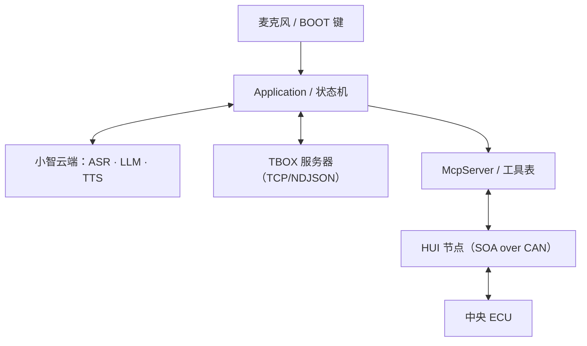

# AI Connector

（中文 | [English](README.md)）

基于 [xiaozhi-esp32](https://github.com/78/xiaozhi-esp32)（MIT）的 ESP32-S3 固件：**一颗芯片、一份固件，同时是 AIBOX 和 TBOX。**

- **AIBOX**：4G Cat.1 联网，接入 Qwen / DeepSeek 等大模型做语音对话（Opus 流，支持服务端 AEC 实时打断）；
- **TBOX**：挂在整车 CAN 总线上，作为 SOA 框架里的 **HUI 节点**，通过 MCP 工具读写中央 ECU；
- **两条控制通道共用同一张工具表**：AI 自己在对话里调，运营人员也能在服务器端选命令下发。

整条链路是：按 BOOT 键说话 → 云端 ASR + LLM + TTS → `tools/call` → 固件按手册把它编码成 CAN 报文 → 中央 ECU 应答 → 原路返回给 AI / 服务器。

## 能力总览

| 能力 | 实现 |
| --- | --- |
| 语音对话 | ES8311 编解码 + NS4150B 功放，I2S 全双工；Opus 流；BOOT 键唤醒；服务端 AEC 支持对话中打断 |
| 网络 | ML307C Cat.1 4G（AT 通道，PWRKEY 开机）；`ml307_net_heal` 自愈看门狗处理模组「掉网 + SIM 不可用」的锁死状态 |
| 车控 | 整车 CAN（TWAI，500 kbps）上的 SOA/HUI 节点，底层是 canard/Cyphal 传输 |
| MCP 工具 | 命令手册 → 每条命令一个 `self.hui.*` 工具，参数是真正的 JSON Schema |
| 双通道 | AI 云端 MCP + 独立的 TBOX 链路（TCP/NDJSON），互不影响 |
| 命令手册 | JSON 打包进 assets 分区，开机即用、不依赖网络，可单独烧写更新 |
| OTA | 继承上游 OTA（`CONFIG_OTA_URL`），MQTT / WebSocket 连接参数由 OTA 下发 |
| 其他 | 无显示屏、无摄像头、无触摸；WS2812 指示灯；多语言提示音（继承上游资源） |

> 本板 `CONFIG_SPIRAM=n`，因此不走 ESP-SR 离线唤醒（AFE / WakeNet 不可用），唤醒方式是 BOOT 键。
> 想启用唤醒词，需先把功放使能从 IO37 飞线到空闲 GPIO —— IO37 是八线 PSRAM 的 DQS。

## 架构

```text
main/
├── application.*            主事件循环、协议生命周期、高层行为
├── device_state_machine.*   运行时状态机（只能经 Application::SetDeviceState 迁移）
├── protocols/               WebSocket 与 MQTT + UDP 两种传输（同一套 Protocol 语义）
├── mcp_server.*             工具表与 tools/call 分发（两条通道共用这一个入口）
├── tbox_link.*              TBOX 独立链路：TCP（可选 TLS）+ 行分隔 JSON
├── soa/
│   ├── Sop/                 SOA 协议层：router + CAN/IPC/UART/ESP-NOW + canard
│   ├── hui.*                HUI 节点（本机在总线上的身份与心跳）
│   ├── hui_rpc.*            同步 read/write/ioctl 事务（串行化 + 超时丢弃迟到应答）
│   ├── hui_manual.*         命令手册加载（assets 分区优先）
│   ├── hui_mcp.*            手册 → MCP 工具
│   └── manuals/             各主机的命令手册 JSON（打包进 assets 分区）
├── boards/es8311-ml307-4g-voice/   本产品唯一的板级实现
└── Kconfig.projbuild        语音 / SOA / TBOX 等配置项
```



## 一张工具表，两条控制通道

| | AI 通道 | TBOX 链路 |
| --- | --- | --- |
| 谁触发 | 云端大模型（`tools/call`） | 服务器端的人选一条命令 |
| 连接 | OTA 下发的 MQTT / WebSocket 配置（第三方后端） | 设备自己连的 TCP，可选 TLS |
| 配置 | OTA 写入 NVS | Kconfig `CONFIG_TBOX_LINK_*`，NVS `tbox` 段优先 |
| 下行报文 | 标准 JSON-RPC | `{"type":"command",name,arguments}`、`{"type":"mcp","payload":…}` 或裸 JSON-RPC |
| 上行回执 | 回 AI 通道 | `{"type":"mcp","payload":…}` 回同一连接 |

设计约束：

- **只有一张工具表。** 两条通道最后都进 `McpServer::CallTool()`，所以参数校验、手册字节编码、工具内的安全门槛只有一份 —— 绕过工具表直接调 `HuiNode_*` 是禁止的，车控场景输不起。
- **必须是独立链路。** AI 后端是第三方、配置由 OTA 下发，我们既改不了它，也不能让 TBOX 服务器借用那条会话。
- **不用第二个 MQTT 客户端。** ML307 的 `MQTTSTATE` URC 不带客户端编号，两个 `Ml307Mqtt` 实例会互相把 `connected_` 清成 false（真机实测：后连的会把先连的打成哑巴），所以 TBOX 链路走 TCP + 行分隔 JSON。
- **连接 id 不能撞。** ML307 上 `CreateTcp/Udp(id)` 的 id 直通 `AT+MIPOPEN=<id>`，被抢占的一方收不到任何 URC、会静默死亡。当前占用：`0` MQTT/HTTP、`1` WebSocket、`2` AI 音频 UDP、`3` 摄像头/升级 HTTP、`4` TBOX 链路。
- **发送失败即重连。** socket 被静默关闭时不会收到 `OnDisconnected`，因此 `SendJson()` 失败就是最可靠的失效信号。

## MCP 工具：从命令手册自动生成

HUI 总线只有三个通用接口：`read`(301) / `write`(302) / `ioctl`(303)。命令号本身不自描述，而且同一功能在不同主机上的命令号完全不同。固件的做法是：

1. 开机后 `read 0x1000` 向中央 ECU 要设备 ID；
2. 按设备 ID 在 assets 分区里找对应的命令手册（联网时也可从后端拉取）；
3. 手册里**每条命令生成一个 MCP 工具**，参数按 `args` 生成真 JSON Schema；
4. 字节编码（大端、ioctl 前 2 字节命令码）由固件完成，AI 只说人话。

```text
self.hui.<alias|host_<device_id>>.<命令名>

self.hui.host1.get_device_id()
self.hui.host1.get_battery()            -> {"command":"FF01","ok":true,"raw":"55","value":85,"unit":"%"}
self.hui.host1.set_headlight(on=true)   -> ioctl F101 01
```

```json
{"jsonrpc":"2.0","id":7,"method":"tools/call",
 "params":{"name":"self.hui.host1.set_headlight","arguments":{"on":true}}}
```

已知上限：`tools/list` 单页 8000 字节、单条描述截到 5500 字节、`HUI_MCP_MAX_TOOLS = 24`。超出的命令不会出现在工具列表里，需要精简手册或按需分组。

详细规则见 [HUI 主机命令手册 → MCP 工具](docs/hui-command-manual_zh.md)。

## 硬件

当前只维护一块板：`es8311-ml307-4g-voice`（ESP32-S3-WROOM-1-N16R8 + ES8311 + ML307C）。完整的引脚表、供电与调试注意事项见 [板级 README](main/boards/es8311-ml307-4g-voice/README.md)。

| 功能 | 引脚 |
| --- | --- |
| 按键（BOOT，唤醒） | IO0（上拉，按下拉低） |
| 指示灯（WS2812） | IO38 |
| 功放使能 PA_EN（高电平开启） | IO37 |
| I2S MCLK / BCLK / LRCK | IO4 / IO15 / IO6 |
| I2S DOUT → ES8311 `DSDIN`（本板是交叉的） | IO5 |
| I2S DIN ← ES8311 `ASDOUT`（本板是交叉的） | IO7 |
| Codec I2C SDA / SCL | IO17 / IO18 |
| 4G UART（ESP TX / RX）、PWRKEY、STATE | IO44 / IO43、IO47、IO48 |
| CAN（TWAI）：TX / RX / STB | IO39 / IO40 / IO41（500 kbps） |
| USB-Serial/JTAG 控制台 | IO19 / IO20（必须保留，不可挪用） |

两个容易踩的坑：

- **I2S 数据线在 PCB 上是交叉的**：ES8311 `DSDIN` 接 ESP `IO5`、`ASDOUT` 接 `IO7`。接成常规的 `DOUT=IO7 / DIN=IO5` 会得到「时钟全对、codec 寄存器全对、喇叭完全无声」。
- **不能开 PSRAM**：IO37 是八线 PSRAM 的 DQS，`CONFIG_SPIRAM=y` 会把它交给 MSPI，`gpio_set_level` 再也驱动不了功放使能 —— 喇叭静音。

## 快速开始

### 环境

- ESP-IDF **v6.0.1 或以上**，推荐 [v6.1](https://github.com/espressif/esp-idf/releases/tag/v6.1)；不支持 IDF 5.x
- VS Code / Cursor + ESP-IDF 插件，或直接用命令行
- 代码风格是 Google C++ Style，改动后请按 [代码风格](docs/code_style.md) 格式化

### 构建

```sh
# 先 source 目标 IDF 环境
. $IDF_PATH/export.sh          # Windows PowerShell: . $env:IDF_PATH\export.ps1

python scripts/build.py --list-boards
python scripts/build.py es8311-ml307-4g-voice --name es8311-ml307-4g-voice
```

> `scripts/build.py` 是板级配置的唯一入口：它会重写本地 `sdkconfig`，并把 `config.json` 里的
> `sdkconfig_append` 叠加进去。不要用裸 `idf.py` 重新配置（会回退到 esp32 并剪掉依赖）。

### 烧写

```sh
idf.py -DIDF_TARGET=esp32s3 -p <COMx> flash monitor
```

一次 `flash` 会同时写入 app 和 assets 分区（里面就是 `main/soa/manuals/*.json`）。只改命令手册时不必重烧 app：

```sh
esptool --chip esp32s3 write-flash 0x800000 build/generated_assets.bin
```

### 主机侧测试

```sh
python -m unittest discover -s scripts/tests -v
```

## 配置

板级默认值在 `main/boards/es8311-ml307-4g-voice/config.json` 的 `sdkconfig_append` 里：

| 配置项 | 说明 |
| --- | --- |
| `CONFIG_SOA_ENABLE` | 启用 SOA 协议层与 HUI 节点 |
| `CONFIG_SOA_ESPNOW_ENABLE` | 同时启用 ESP-NOW 传输（台架上可代替 CAN 联调） |
| `CONFIG_HUI_RPC_TIMEOUT_MS` | HUI 事务超时。中央 ECU 应答约 500 ms，太紧会「每次都超时 + 丢弃迟到应答」，表现为拿不到设备 ID、AI 看不到工具 |
| `CONFIG_HUI_MANUAL_READ_TIMEOUT_MS` | 命令手册（flash / 网络）读取超时 |
| `CONFIG_TBOX_LINK_ENABLE` | 启用 TBOX 独立链路 |
| `CONFIG_TBOX_LINK_ENDPOINT` | `host:port` |
| `CONFIG_TBOX_LINK_TLS` | 链路走 TLS |
| `CONFIG_TBOX_LINK_CHANNEL` / `CLIENT_ID` / `TOKEN` | 链路标识与鉴权 |
| `CONFIG_TBOX_COMMAND_MESSAGE` | 台架版本：让 AI 通道直接接受 `{"type":"command",…}`，不需要独立链路 |
| `CONFIG_OTA_URL` | 保持默认的小智云端即可；指向测试 TSP 会让语音通道握手失败（按键「没反应」） |
| `GNSS_TEST` / `NET_HEAL_ENABLE`（板级 `config.h`） | GNSS 定位自测任务 / 4G 自愈看门狗开关 |

运行时可以用 NVS（命名空间 `tbox`）覆盖 endpoint / channel / client_id / token / ping，出厂后改地址不用重新编译。

## 台架与测试服务器

`scripts/tsp_server.py` 一个进程同时提供三种入口，用于没有真实后端时联调：

- OTA 端点（HTTP 8000）+ MQTT broker（1883），供 **AI 通道**；
- TCP / NDJSON（9000），供 **TBOX 链路**；
- 网页控制台：列设备、拉 `tools/list`、按工具名下发命令、看回执。

细节见 [测试 TSP 使用说明](docs/tsp-test-server_zh.md)。几点务必记住：

- 公网测试服务器**必须鉴权**（MQTT 用户名/密码 + TCP hello 里的 token），否则任何人都能往设备直投车控命令；
- 别把 `CONFIG_OTA_URL` 指向测试 TSP：它没有实现音频通道握手，按键唤醒会「没反应」；
- 只改命令手册时，`python scripts/hui_manual_server.py --check` 是最快的校验方式。

## 文档

| 文档 | 内容 |
| --- | --- |
| [板级 README](main/boards/es8311-ml307-4g-voice/README.md) | 引脚、硬件资源、CAN/HUI 说明 |
| [HUI 命令手册 → MCP 工具](docs/hui-command-manual_zh.md) | 手册格式、工具命名、编解码规则 |
| [测试 TSP 使用说明](docs/tsp-test-server_zh.md) | OTA + MQTT + TCP 台架服务器 |
| [SOA 协议层说明](main/soa/Sop/README.md) | 路由表语义、各传输的线格式与线程模型 |
| [MCP 协议交互流程](docs/mcp-protocol_zh.md) / [用法说明](docs/mcp-usage_zh.md) | 设备端 MCP 的实现与调用方式 |
| [MQTT + UDP](docs/mqtt-udp_zh.md) / [WebSocket](docs/websocket_zh.md) | 大模型通信协议 |
| [自定义开发板指南](docs/custom-board_zh.md) | 新增板卡时 `config.json` → Kconfig → CMake 的完整链路 |

## 与上游的关系

- 语音对话、协议（WebSocket / MQTT + UDP）、音频、OTA 等基础能力来自 [78/xiaozhi-esp32](https://github.com/78/xiaozhi-esp32)。
- 本项目在其上增加了：SOA 协议层与 HUI 节点、命令手册驱动的动态 MCP 工具、TBOX 独立链路、4G 自愈看门狗，以及一块专用板卡。
- 只维护 `main/boards/es8311-ml307-4g-voice` 一块板；上游其他板卡目录原样保留，方便后续取用。

## 许可

MIT，见 [LICENSE](LICENSE)。上游 xiaozhi-esp32 同为 MIT 许可；`main/soa/Sop/canard` 沿用 OpenCyphal 的 MIT 许可。
