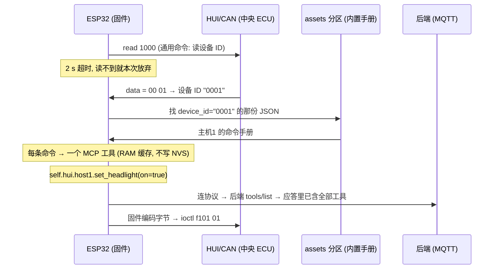

# HUI 主机命令手册 → MCP 工具

> 参考数据（不是固件内容）：`main/soa/manuals/` 下的 `common.json` / `host1.json` / `host2.json`
> 相关代码：`main/soa/hui_rpc.*`（同步调用）、`main/soa/hui_manual.*`（手册模型/拉取）、`main/soa/hui_mcp.*`（MCP 工具）

## 1. 要解决的问题

HUI 总线只有三个**通用**接口，命令号本身不自描述：

| 接口 | DSDL 服务 | 请求字段 | 应答字段 |
| --- | --- | --- | --- |
| read | `HuiRead` (port 301) | `sub_service: u16` | `error: u8`, `data: u8[<=8]` |
| write | `HuiWrite` (port 302) | `sub_service: u16`, `data: u8[<=8]` | `error: u8` |
| ioctl | `HuiIoctl` (port 303) | `data: u8[<=8]` | `error: u8`, `data: u8[<=8]` |

"`read 0xFF01` 到底是读电量还是读速度"只有主机手册知道，而**同一类功能在不同主机上的命令号完全不同**（主机1 是 `ff01`，主机2 是 `f110`）。所以流程是：



## 2. 每条命令一个工具

拿到手册后，**手册里每条命令生成一个 MCP 工具**：

```
self.hui.<alias|host_<device_id>>.<语义名>
例： self.hui.host1.get_battery()
     self.hui.host1.set_headlight(on = true)
     self.hui.host2.set_emergency_light(on = false)
```

工具的参数是真正的 JSON Schema（由手册的 `args` 生成），所以：

- **类型/范围/长度在 `DoToolCall` 里就拦住**，非法值根本到不了 CAN 总线（`-32602`）；
- **字节编码（大端 / ioctl 前 2 字节命令码）由固件完成**，AI 只说人话：

```json
{"jsonrpc":"2.0","id":7,"method":"tools/call",
 "params":{"name":"self.hui.host1.set_headlight","arguments":{"on":true}}}
```

设备返回（`result.content[0].text` 是一段 JSON）：

```json
{"command":"F101","name":"set_headlight","ok":true}
```

`read` 的返回带手册里的解码结果：

```json
{"command":"FF01","name":"get_battery","ok":true,"raw":"55","value":85,"unit":"%"}
```

- `value` 是数值（`value.scale`、`value.offset` 已换算），`hex` / `bool` 类型返回字符串，`raw` 永远是原始字节。
- 解码失败时保留 `raw` 并附 `decode_error`（不当作调用失败 —— 字节确实拿到了）。

### 注册时机（关键）

工具在 `Board::PrepareBeforeConnect()` 里**同步注册一次**，之后 `tools_` 只读。

这个时机不是随便选的。实测数据（`es8311-ml307-4g-voice` + `api.tenclass.net`，MQTT）：

| 时刻 | 事件 |
| --- | --- |
| t≈5.4 s | 4G 起网 |
| t≈8.4 s | 版本检查结束，`PrepareBeforeConnect()` 在这里跑（`read 1000` + 查 flash）|
| t≈9.4 s | 协议连上，`Activation done` |
| t≈9.6 s | **后端发 `tools/list`，只晚 190 ms** |

所以注册必须**早于连协议**。曾经的实现是"连上后由后台任务拉手册再注册"，结果第一次
`tools/list` 里没有 `self.hui.*`；而后端不理会 `notifications/tools/list_changed`，
AI 就永远看不到这些工具。

代价：`read 1000` 最多阻塞 2 s（`HUI_MANUAL_READ_TIMEOUT_MS`），会推迟联网。读不到就
**本次放弃**，只注册本机工具，不重试。

### 工具数量预算

`tools/list` 单页上限是 8000 字节，所以生成的工具数量封顶 `HUI_MCP_MAX_TOOLS`（`hui_mcp.cc`，默认 24）。超出预算的命令**不生成工具**，串口会打印还有多少条被省略。

唯一的扩容办法是调大 `HUI_MCP_MAX_TOOLS` —— 但**必须先确认后端会跟 `nextCursor` 翻页**，
否则第 2 页的工具 AI 根本收不到。另一个方向是精简手册（合并语义相近的命令）。

## 3. 编码约定

- **命令号一律十六进制**（手册里的 `id`，如 `"1000"` = `0x1000`）。
- **多字节一律大端**（MSB first）。这与设备 ID（`read 1000` 返回 2 字节大端）一致。
- **ioctl 的 payload** = `[命令码高字节, 命令码低字节]` + 参数，总长 ≤ 8 字节（DSDL 的数组容量）。
- **write 的参数**直接就是 `data`，≤ 8 字节；命令号走 `sub_service`。
- **入参的 `scale`/`offset` 不参与编码**（用了会打 warning）：AI 只能给整数，小数换算让大模型心算不可靠。
  量化请写进 `unit`，值按线上整数传：`"unit": "0.1 km/h"`、描述里写 "80.0 km/h 填 800"。
  返回侧（`value`）的 `scale`/`offset` 正常生效 —— 那是固件在解码。
- 入参类型 → JSON Schema 的映射：

| 手册 `type` | Schema 类型 | 范围 |
| --- | --- | --- |
| `u8` / `i8` | integer | 0~255 / -128~127 |
| `u16` / `i16` | integer | 0~65535 / -32768~32767 |
| `u32` / `i32` | integer | 收窄到 int32（`Property` 只能存 `int`，超出会告警）|
| `bool` | boolean | — |
| `hex` | string | `maxLength` = `bytes`×2（`bytes` 缺省按 8 字节）|

## 4. 手册 JSON 格式

后端按设备 ID 返回一份文档；`common.json` 里的通用命令由后端合并进 `commands` 一起下发。

```json
{
  "schema": 1,
  "device_id": "0001",
  "alias": "host1",
  "name": "主机1",
  "description": "给 AI 看的一句话说明",
  "commands": [
    {
      "id": "ff01",
      "kind": "read",
      "name": "get_battery",
      "description": "获取电量",
      "value": { "type": "u8", "unit": "%" }
    },
    {
      "id": "f101",
      "kind": "ioctl",
      "name": "set_headlight",
      "description": "打开/关闭大灯",
      "args": [{ "name": "on", "type": "u8", "description": "0=关闭, 1=打开" }]
    }
  ]
}
```

上例会生成 `self.hui.host1.get_battery` 和 `self.hui.host1.set_headlight` 两个工具。

| 字段 | 必填 | 说明 |
| --- | --- | --- |
| `id` | ✅ | 1~4 位十六进制命令号。read/write = `sub_service`；ioctl = payload 前 2 字节 |
| `kind` | | `read` / `write` / `ioctl`，缺省 `read` |
| `name` | | **工具名的一部分**（`self.hui.<alias>.<name>`），建议 `get_battery` 这类语义名 |
| `description` | | 工具描述，**直接给 AI 看**；写清"干什么、参数怎么填" |
| `value` | | 应答编码方式，见下 |
| `args` | | 入参，按 payload 顺序；**决定工具的 JSON Schema** |

`alias` 缺省时用 `host_<device_id>`（如 `self.hui.host_0001.*`）；`name` 缺省或含非法字符时用 `cmd_<id>`。
命令重名会自动补命令号消歧（`set_headlight_F101`）。

`value` / `args` 里的字段：`name`、`type`、`description`、`scale`（默认 1）、`offset`（默认 0）、`unit`、`bytes`（仅 `hex`）。

`type` 取值：`u8` `i8` `u16` `i16` `u32` `i32` `bool` `hex`（缺省 `hex` = 原样返回字节）。

解析失败的**单条命令会被跳过并打 warning**，不会让整本手册作废；一本手册里一条可用命令都没有才算加载失败。

## 5. 手册来源：flash 内置 or 服务端下发

固件支持两个来源，由 `HUI_MANUAL_SOURCE` 决定（默认 **flash 优先**）：

| 取值 | 行为 | 适用 |
| --- | --- | --- |
| `FLASH_FIRST`（默认） | 先按设备 ID 在 assets 分区里找，没找到才联网 | 台架/离线可用；以后有服务端了不用改代码就能补主机 |
| `FLASH_ONLY` | 只用 flash，完全不联网 | 手册跟固件一起出厂 |
| `HTTP_ONLY` | 忽略 flash 里的副本，只信任服务端 | 服务端当唯一权威来源 |

### 5.1 flash 内置（`main/soa/manuals/*.json`）

构建时 `main/CMakeLists.txt` 会把这个目录交给 `build_default_assets.py --extra_files`，
每个 json 变成**已有的 8MB assets 分区**里的一个条目：

```
assets,   data, spiffs,  0x800000,  8M     ← partitions/v2/16m.csv
```

- **不占 app 分区、不用改分区表**（16MB 的表已经排满）。
- 运行时用 `Assets::GetAssetData(name)` 读（mmap 零拷贝），先例见
  `main/audio/wake_words/custom_wake_word.cc`。
- 文件名不参与匹配：固件先读 `index.json` 的 `extra_files` 枚举文件名，逐个解析后
  **按手册里的 `device_id` 认**；另外也支持约定文件名 `<设备ID>.json`（如 `0001.json`）。
- 因此换主机/改手册**只需重烧 assets 分区，不用动 app**：

```powershell
esptool --chip esp32s3 write-flash 0x800000 build\generated_assets.bin
```

⚠️ 三个坑：

1. `GetAssetData()` 返回的是 **mmap 指针，不是 NUL 结尾的字符串** —— 必须带长度解析
   （固件里已用 `cJSON_ParseWithLength` / 带长度的 `std::string`）。
2. **文件名 ≤ 32 字节**（`pack_assets_simple` 用固定宽度字段存名字，超了会被截断，
   名字一变固件就找不到了）。
3. `--extra_files` 只接受 **1 个目录**。若别的板级配置也占用了
   `DEFAULT_ASSETS_EXTRA_FILES`（目前只有 ESP-HI 的 emoji），CMake 会打 warning 并且
   **手册不会被打包** —— 这种情况下要先把两个目录合并。

### 5.2 服务端下发（HTTP）

- `GET` 返回 `200` + `Content-Type: application/json`，body 就是上面那份 JSON。
- URL 模板里的 `%s` 替换成设备 ID；模板里没有 `%s` 时固件会退化成追加 `?device_id=<id>`。
- 设备 ID 未知/手册缺失时建议返 `404`（固件会在串口打 `HTTP 404` 并等下次重试）。
- 只有 flash 里没找到对应主机时才会联网（`FLASH_FIRST`），拉取失败后有 3 s 冷却。

### 台架用的本地手册服务

`scripts/hui_manual_server.py`（纯 stdlib，无依赖）把 `main/soa/manuals/` 按设备 ID 发出去，
并自动把 `common.json` 的通用命令合并进每台主机：

```sh
python3 scripts/hui_manual_server.py                 # 监听 0.0.0.0:8080
python3 scripts/hui_manual_server.py --port 9000
python3 scripts/hui_manual_server.py --check         # 只校验手册, 不启服务
```

启动后会直接打印可以粘进板级 `config.json` 的那行配置（含本机局域网 IP）：

```
"CONFIG_HUI_MANUAL_URL=\"http://192.168.1.23:8080/api/hui/manual?device_id=%s\""
```

路由：

| 路由 | 说明 |
| --- | --- |
| `GET /` | 索引页（已识别的主机 + 可直接点的手册链接）|
| `GET /healthz` | 健康检查，返 `ok` |
| `GET /api/hui/manual?device_id=0001` | **固件用这个**（`HUI_MANUAL_URL` 默认模板）|
| `GET /api/hui/manual/0001.json` | 同上，路径写法，方便浏览器/curl |

- 文件名不参与索引：按 JSON 里的 `device_id` 建索引（宽松匹配：`1`、`0x0001`、`0001` 都认）。
- 每次请求打印一行摘要（`[OK 200] 主机1 (device_id=0001, 5 条命令)`），可直接看到固件是否真的来拉了。
- 未知设备 ID 返 `404` 并列出已知的 ID，方便分辨"主机号上报得不对"还是"服务端没配"。
- **板子走 4G 时在运营商 NAT 后面**，访问不到这个地址：要么让板子连同一局域网的 WiFi，要么把端口映射出去。
- 改了手册 JSON 直接生效（响应带 `Cache-Control: no-store`），但固件有 RAM 缓存 ——
  要让它重新拉：重启，或调 `HuiManual_Invalidate()`（见§7）。

## 6. 配置

```sh
idf.py menuconfig   # SOA (Service-Oriented Architecture)
```

| 选项 | 默认 | 说明 |
| --- | --- | --- |
| `HUI_MANUAL_SOURCE` | `FLASH_FIRST` | 来源选择：flash 优先 / 只 flash / 只 HTTP（见§5）|
| `HUI_MANUAL_URL` | 空 | 服务端地址，`%s` = 设备 ID。只用 flash 时不需要配 |
| `HUI_RPC_TIMEOUT_MS` | 1500 | 每个 read/write/ioctl 事务的应答超时 |
| `HUI_MANUAL_READ_TIMEOUT_MS` | 2000 | 加载手册前那次 `read 1000` 的超时（**会阻塞激活流程**）|
| `HUI_MANUAL_TIMEOUT_MS` | 3000 | 拉手册的 HTTP 超时 |
| `HUI_MANUAL_MAX_BYTES` | 8192 | 手册大小上限（flash 和 HTTP 两个来源都适用）|

工具数量上限不在 Kconfig 里，而是 `hui_mcp.cc` 的 `HUI_MCP_MAX_TOOLS`（见§2 的预算说明）。

也可以写在板级 `config.json` 的 `sdkconfig_append` 里：

```json
"CONFIG_HUI_MANUAL_URL=\"http://192.168.1.100:8080/%s.json\""
```

## 7. 加一台新主机

**走 flash（默认/离线）**：

1. 在 `main/soa/manuals/` 里加一份手册 JSON（照 `host1.json` 的样子），`device_id` 填该主机
   `read 1000` 上报的 ID，文件名叫什么都行（≤32 字节）。
2. 重新构建（CMake 会把它打进 assets 分区），只需要烧 assets 分区：
   `esptool write-flash 0x800000 build\generated_assets.bin`。
3. 让固件重新读：**重新上电**（工具只在 `PrepareBeforeConnect()` 里注册一次，刻意没有
   热重载路径 —— 换来的是"注册后只读"，整条路径不需要任何锁）。

**走服务端（有后端之后）**：

1. 后端加一份同名格式的 JSON，按 `?device_id=` 返回它。
2. 把 `HUI_MANUAL_SOURCE` 改成 `HTTP_ONLY`（或保留 `FLASH_FIRST` 当兜底），再配
   `HUI_MANUAL_URL`。**调用点不用改**（`hui_manual.cc` 的 `LoadLocked()` 已经处理好
   两个来源的顺序）。

## 8. 已知限制

- **本次开机没有"补注册"机会**：工具只在连协议前注册一次。`read 1000` 超时或 flash 里没有
  对应主机，本次开机就**只有本机工具**，要重启才有 —— 后端在连上后约 190 ms 就问
  `tools/list`，且不理会 `notifications/tools/list_changed`，补注册赶不上（见§2 注册时机）。
- **工具数量有预算**：`tools/list` 单页 8000 字节 → `HUI_MCP_MAX_TOOLS` 默认 24。超出的命令不生成工具（串口有告警）。
- **应答里没有命令号** → 无法把一帧应答对应回某个请求，所以 `hui_rpc` 用互斥量串行化，同一时刻只允许一个在途事务。超时后会把下一帧迟到应答丢掉，避免错配。**不要在 CAN 回调里再调 `HuiRpc_*`**（会和自己死锁）。
- **工具回调跑在主任务**上，等待 CAN 应答期间用 `TaskPriorityReset` 降优先级（`HUI_MCP_WAIT_PRIORITY`）；总线忙导致超时就调大 `HUI_RPC_TIMEOUT_MS`。
- **手册大小上限**：`HUI_MANUAL_MAX_BYTES`（默认 8192）对 flash 和 HTTP 两个来源都生效；flash 里超限的文件会被跳过并告警。
- **flash 文件名 ≤ 32 字节**，且必须能被 `index.json` 的 `extra_files` 枚举到（或叫 `<设备ID>.json`），否则固件找不到它。
- **两种来源都需要成功的 `read 1000`**：设备 ID 是定位手册的依据，所以 CAN 没通就一部手册也加载不了（不会拿单份手册去猜）。
- **手册只在 RAM 缓存**（按需求不写 NVS）。HTTP 拉取失败后有 3 s 冷却，避免 AI 连续调用时反复卡 HTTP 超时；flash 读取不受冷却影响。
- **`McpServer` 保持"只注册一次、之后只读"**：`tools_` 仍是 `unique_ptr`，不加锁。这是刻意的
  —— 注册全部发生在连协议之前，之后没有任何任务会改动工具集。
- **尚未在真机验证**：CAN 侧需要真实中央 ECU 或总线模拟器；flash 打包格式有 host 侧测试
  （`scripts/tests/test_hui_flash_manuals.py`）守着，但那验证的是镜像格式，不是板子上的实际读取。

## 9. 文件清单

| 文件 | 职责 |
| --- | --- |
| `main/soa/hui_rpc.h/.cc` | 三个服务的同步调用（串行化 + 超时 + 迟到帧丢弃） |
| `main/soa/hui_manual.h/.cc` | 手册模型、JSON 解析、设备 ID 读取、HTTP 拉取与 RAM 缓存 |
| `main/soa/hui_mcp.h/.cc` | 按手册生成具体工具、拼 schema、编码参数、解码结果 |
| `main/soa/hui.cc` | 三个应答回调 → `HuiRpc_OnResponse()`（原来只有 TODO 空实现） |
| `main/soa/manuals/*.json` | 参考手册 / flash 内置手册（构建时打进 assets 分区）|
| `scripts/hui_manual_server.py` | 台架用的本地手册服务（按 `device_id` 下发 + 合并通用命令）|
| `scripts/tests/test_hui_manual_server.py` | 上面那个服务的单测（含"仓库自带手册必须干净"的回归断言）|
| `scripts/tests/test_hui_flash_manuals.py` | 校验手册真的进了 assets 镜像，且格式与固件读法一致 |
| `main/mcp_server.h/.cc` | 新增 `SetToolDescription()` / `RemoveTool()` / `RemoveToolsByPrefix()`，`tools_` 改用 `shared_ptr`，`Property` 支持 `description` |
